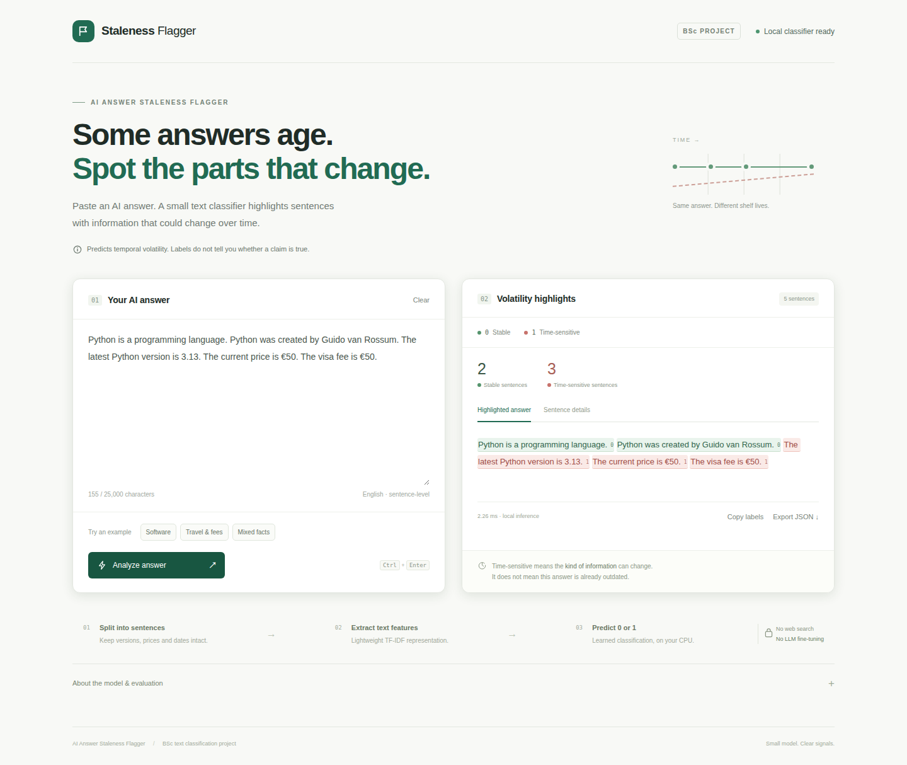

# AI Answer Staleness Flagger

A BSc project that predicts **whether a sentence's information could change over time**.

**0 = STABLE 🟢** · **1 = TIME-SENSITIVE / VOLATILE 🔴**

It is a supervised **TF-IDF + Logistic Regression classifier**, trained from labeled text. There is no large language model, no pretrained-model fine-tuning, no fact checking, and no web search during training or inference. Only the optional, one-time dataset download needs internet.

```text
AI answer → sentence splitting → text preprocessing → TF-IDF → classifier → 0/1
```

This follows the simple text-classification structure of a MELD-style student project. MELD's emotion labels do not match temporal volatility, so MELD is not used as training data.

## Run the application

Python 3.11 or newer. The prepared data and trained model are already included in this workspace.

```bash
cd /home/x-hunter/flagger
python -m venv .venv
source .venv/bin/activate
python -m pip install -e '.[dev]'
python -m uvicorn flagger.app:app --host 127.0.0.1 --port 8000
```

Open **http://127.0.0.1:8000**. Paste an English AI answer and click **Analyze answer**. The app provides green/red highlights, sentence details, volatility scores, a decision threshold, copied labels, and JSON export. All inference runs on the local CPU. Inputs are not persisted by the application.

On Windows, activate the environment with `.venv\Scripts\activate`. Run the commands from the project directory; replace the `cd` path if you move the project. The editable installation keeps the CLI connected to this source checkout and its model files.



## Examples

| Claim | Label |
|---|---|
| The Earth orbits the Sun. | 🟢 0 |
| Python was created by Guido van Rossum. | 🟢 0 |
| Python is a programming language. | 🟢 0 |
| The latest Python version is 3.13. | 🔴 1 |
| The current price is €50. | 🔴 1 |
| The current CEO is John Smith. | 🔴 1 |
| The visa fee is €50. | 🔴 1 |
| The visa fee was €50 in 2010. | 🟢 0 |

An explicitly completed historical event stays stable even if its present-day equivalent changes. A definition such as “An electric current is a flow of electric charge” also stays stable. A false statement such as “The Earth is shaped like a cube” can receive **0**, because this classifier does not judge truth. Example prices, names and version numbers are illustrative; they were not checked for present-day accuracy.

## Dataset and training

The public source is [EverGreenQA / s-nlp/EverGreen-Multilingual](https://huggingface.co/datasets/s-nlp/EverGreen-Multilingual), associated with [Will It Still Be True Tomorrow?](https://arxiv.org/abs/2505.21115). It already has relevant binary labels for **questions**. This project reverses the source mapping: `is_evergreen=1 → STABLE=0`; `is_evergreen=0 → VOLATILE=1`.

For the answer-sentence task, it adds short source answers with explicitly **weak inherited labels**, plus 360 individually written project statements. Project statements are **assistant-authored and rubric-labeled, not independently human-annotated**. Their labels and source-answer adaptations need human review for a final BSc research submission. Provenance and annotation status appear in each processed CSV row.

Training and validation have **3,159** and **785** examples. The two separate test sets are the **1,270 official questions** and **100 project-authored statements**. Exact normalized texts and question/family groups are disjoint across splits. Source questions and their answers stay in the same split. User-provided examples are training/regression cases, not accuracy evidence.

```bash
# Retrain offline from included prepared CSVs; no download needed.
python scripts/train.py

# Optional: reproduce dataset preparation from pinned public source files.
python scripts/prepare_data.py

# Rebuild from cached raw sources without network access.
python scripts/prepare_data.py --offline
```

The downloader uses the pinned author GitHub repository because its CSV also supplies English answers omitted by the Hugging Face question dataset. It records revision IDs and SHA-256 checksums. Raw downloads stay in `data/raw/`. See [dataset research](docs/dataset_research.md) and the [annotation rubric](docs/annotation_guide.md).

Three small classifiers are compared: word TF-IDF + Logistic Regression, word/character TF-IDF + Logistic Regression, and word TF-IDF + Multinomial Naive Bayes. Selection uses macro-F1 on validation statements only. Word TF-IDF + Logistic Regression won. The evaluated model is saved without folding validation or test data into training.

## Measured results

| Held-out set | Accuracy | Macro-F1 | Volatile precision | Volatile recall |
|---|---:|---:|---:|---:|
| Official questions, n=1,270 | 86.0% | 0.818 | 0.714 | 0.749 |
| Project-authored statements, n=100 | 84.0% | 0.840 | 0.854 | 0.820 |

The selected model trained in about **0.1 seconds** and its compressed artifact is about **253 KiB** on this machine. These are local measurements. Question accuracy is not claim accuracy, and the small assistant-authored test is not a general-purpose benchmark. Full comparisons, confusion matrices and errors are in [reports/evaluation.md](reports/evaluation.md), [reports/metrics.json](reports/metrics.json), and [reports/errors.csv](reports/errors.csv).

## CLI, API and verification

```bash
python -m flagger.cli 'Python is a programming language. The latest Python version is 3.13.'
python -m flagger.cli --json 'The current price is €50.'
python -m pytest -q
```

After `pip install -e .`, `staleness-flagger` is also available. Pipe an answer through stdin if preferred. API documentation is at `/docs` while the server runs.

```bash
curl http://127.0.0.1:8000/api/analyze \
  -H 'Content-Type: application/json' \
  -d '{"answer":"The Earth orbits the Sun. The visa fee is €50.","threshold":0.5}'
```

Tests verify required examples, decimal/version splitting, abbreviations, historical claims, label mapping, split leakage, limits, API behavior and inference with network connections blocked. Desktop/mobile browser checks also cover actual highlighting, Unicode offsets, copy/export and HTML text escaping; see [reports/verification.md](reports/verification.md).

## Project structure

```text
flagger/                 Preprocessing, model, inference, API, CLI
scripts/prepare_data.py   Pinned source download, adaptation, split audit
scripts/train.py          Classifier comparison, training, evaluation
data/curated_*.tsv        Individually written statement examples and labels
data/processed/           Ready-to-train CSVs and provenance manifest
models/                  Trained classifier and metadata
web/                     Browser interface; no external assets
tests/                   Meaningful behavior and offline-inference tests
notebooks/bsc_demo.ipynb  CPU training and demonstration, also usable on Kaggle
docs/                    Dataset research, annotation guide, BSc methodology
reports/                 Metrics, errors, learned features, app previews
```

See [docs/bsc_methodology.md](docs/bsc_methodology.md) for the research question, methods, experimental protocol and project limitations. Kaggle is optional: this classifier trains quickly on a laptop CPU, so no hosted training job or GPU is necessary. The notebook and [Kaggle instructions](docs/kaggle.md) are provided for reproducible student experiments.

## Scope and limitations

This English baseline uses sentences, newlines and semicolons as units. It preserves common abbreviations, decimal prices and version numbers, but it does not extract independent atomic facts from complex sentences, resolve pronouns, or reliably identify non-factual text. Markdown headings and fenced code are skipped. Mixed sentences receive one label and should be split manually for finer analysis.

Lexical models can miss implied volatility, overreact to familiar words, or misread historical qualifiers. Binary labels collapse different change rates. Scores are uncalibrated estimates of volatility, not probabilities of factual correctness, and **0 does not mean a claim is trustworthy**. Test errors remain visible in the report; improving the dataset and reviewing it with independent annotators are the next research steps.

Only load this project's trusted `joblib` model. To reproduce it on a different scikit-learn version, rerun training from the included CSVs.
