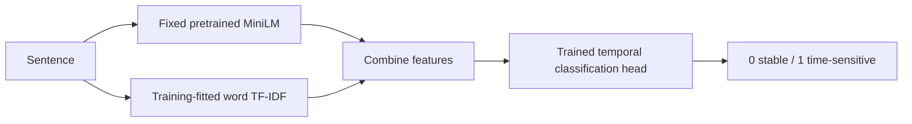

# Semantic classifier research and design

Research date: 8 October 2026. Exa Search returned 12 results across two targeted searches; five primary pages were fetched for the MELD architecture and sentence-classification design. The relevant MELD is the AI text detector, rather than the unrelated emotion dataset.

## What MELD does

[MELD's paper](https://arxiv.org/abs/2605.06903) describes a shared pretrained bidirectional encoder with an AI/human classification head and auxiliary generator, attack and domain heads. Its training combines multiple objectives, including clean/attacked-text consistency and hard negatives. Its purpose is authorship detection, so its output cannot be interpreted as a temporal-stability label.

The [public model card](https://huggingface.co/anon-review-meld-2026/meld) uses an Ettin encoder with custom scoring code. The paper and current release describe different backbone sizes; reproducing that research would require the matching checkpoint, data and training protocol. This project does not reproduce MELD, download its detector weights or claim equivalent robustness.

## Implemented architecture

The useful shared idea is a pretrained sentence representation followed by a task-specific supervised classifier. This project uses [all-MiniLM-L6-v2](https://huggingface.co/sentence-transformers/all-MiniLM-L6-v2), a sentence encoder that produces 384-dimensional vectors. Its pretrained contextual features contribute semantic information even when exact words differ.

The fixed encoder is combined with lexical features because tense, dates and temporal qualifiers still matter. The classifier learns the target labels from 3,223 project training rows. The [SetFit classification-head documentation](https://huggingface.co/docs/setfit/main/how_to/classification_heads) also separates sentence embeddings from a supervised head. Unlike the full [SetFit training procedure](https://huggingface.co/docs/setfit/main/conceptual_guides/setfit), this implementation leaves the encoder fixed and performs no contrastive fine-tuning.

The existing sentence splitting, label mapping, threshold, probabilities, source offsets and count-only summaries are preserved. A trusted local model loads its encoder directory relative to the artifact, so moving the project does not depend on the original absolute path. Runtime uses CPU and local files only. The pinned checkpoint is installed once during training, with an offline option for cached assets.

## Comparison and selection

A fixed grid compares embedding weights 0.5, 1, 2 and 4, plus a semantic-only variant, with Logistic Regression `C` values 1, 4 and 16. The 54 existing authored validation statements select settings. Both original test sets and the 60-statement paraphrase diagnostic remain outside training and selection.

Validation chose the combined model with embedding weight 0.5 and `C=4`. Its validation macro-F1 is 0.944, compared with 0.926 for the lexical baseline and 0.833 for the best semantic-only head. Preserving temporal wording alongside semantic features was therefore supported by validation.

| Held-out exercise | Lexical baseline | Semantic combination |
|---|---:|---:|
| Official questions, 1,270 rows | 86.2% | 86.9% |
| Authored statements, 100 rows | 84.0% | 95.0% |
| Authored paraphrase diagnostic, 60 rows | 81.7% | 88.3% |

The authored sets use rubric labels supplied by the assistant, not independent human annotation. Paraphrase families share topics with development data, although their exact normalized text is excluded from development. They are small diagnostic exercises, not evidence of general-purpose accuracy or factual knowledge. Every remaining evaluation error is exported to [errors.csv](../reports/errors.csv).

## Training time and remaining limits

The measured CPU run spent 22.88 seconds preparing train/validation features and 0.80 seconds fitting the selected head. The complete comparison and evaluation took about 54 seconds. These timings exclude the encoder's original pretraining; fitting a small head quickly does not mean the sentence encoder was trained from scratch in one second.

The final model still misses some implied forecasts and confuses some historical prices and officeholder statements. It predicts one temporal label per sentence, truncates sentence representations at 256 wordpieces and has uncalibrated scores. It does not retrieve current facts or decide whether statements are true. Independent annotation and a larger untouched statement benchmark are needed before stronger performance claims.
